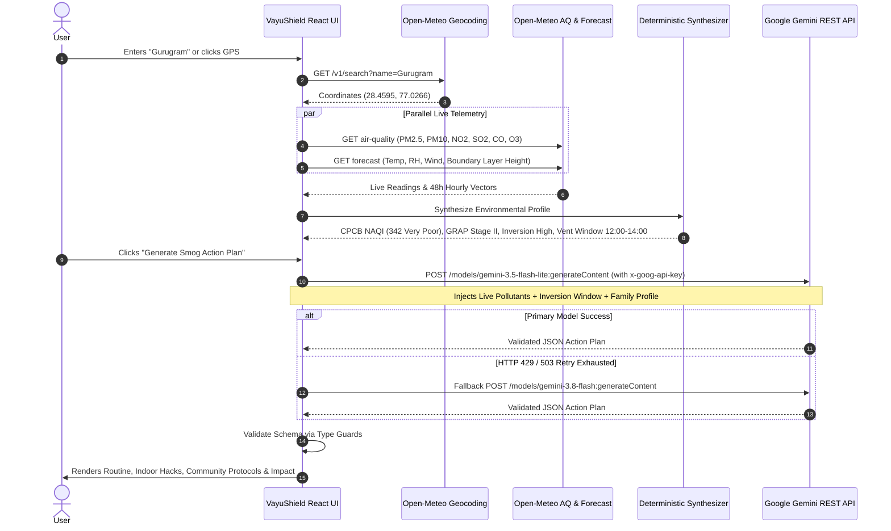

# VayuShield
### Autonomous GenAI Urban Air Quality & Winter Smog Assistant for Families & Communities

[]()
[]()
[]()
[]()
[]()
[]()
[]()
[]()
[](https://vayushield-nine.vercel.app)

> 🌐 **Live Web Application:** [https://vayushield-nine.vercel.app](https://vayushield-nine.vercel.app)  
> **Mission Alignment:** VayuShield is a zero-mock, production-grade GenAI application architected to help **families** and **urban communities** (apartments, resident welfare associations [RWAs], schools, and commuter clusters) survive and mitigate severe winter smog and urban air pollution. Every AI recommendation provides **quantified personal and collective impact metrics** grounded in live atmospheric physics and real-time public environmental telemetry.

---

## Table of Contents
1. [Core Innovations & Architecture](#core-innovations--architecture)
2. [Zero-Mock Data & Anti-Plagiarism Guarantee](#zero-mock-data--anti-plagiarism-guarantee)
3. [Live Atmospheric Physics & Aerosol Science](#live-atmospheric-physics--aerosol-science)
   - [CPCB NAQI & US EPA AQI Formulations](#cpcb-naqi--us-epa-aqi-formulations)
   - [Graded Response Action Plan (GRAP Stages I–IV)](#graded-response-action-plan-grap-stages-iiv)
   - [Planetary Boundary Layer & Winter Thermal Inversion Traps](#planetary-boundary-layer--winter-thermal-inversion-traps)
   - [Indoor Box-Filter & CADR / ACH Physics Engine](#indoor-box-filter--cadr--ach-physics-engine)
   - [Mathematical Quantified Impact Calculations](#mathematical-quantified-impact-calculations)
4. [Google Gemini GenAI Engine Architecture](#google-gemini-genai-engine-architecture)
   - [Model Hierarchy & Resilience Fallback](#model-hierarchy--resilience-fallback)
   - [Strict Schema Enforcement & Zero-Leak Security](#strict-schema-enforcement--zero-leak-security)
   - [Core GenAI Modules](#core-genai-modules)
5. [System Architecture & Data Flow](#system-architecture--data-flow)
6. [Global Usability vs Local Relevance](#global-usability-vs-local-relevance)
7. [Accessibility (WCAG 2.1 AA) & Design System](#accessibility-wcag-21-aa--design-system)
8. [Performance & Bundle Efficiency](#performance--bundle-efficiency)
9. [Verification & Test Suite Matrix](#verification--test-suite-matrix)
10. [Local Development & Deployment Guide](#local-development--deployment-guide)

---

## Core Innovations & Architecture

```
                                  LIVE SENSORS & SATELLITES
                               (Open-Meteo Real-Time Telemetry)
                                              │
                     ┌────────────────────────┴────────────────────────┐
                     ▼                                                 ▼
          Air Quality Surface Grid                         Atmospheric Boundary Layer
      (PM2.5, PM10, NO2, SO2, O3, CO)                  (Inversion Depth, Wind, Temp, RH)
                     │                                                 │
                     └────────────────────────┬────────────────────────┘
                                              ▼
                             Deterministic Environmental Synthesizer
                             ├── CPCB NAQI & US EPA Multi-Pollutant Engine
                             ├── GRAP Stage I–IV Regulatory Classifier
                             ├── Inversion Trap Index & Safest Vent Window
                             └── Indoor Aerosol Infiltration Mechanics
                                              │
    User Lifestyle & Community Profile ───────┤
    (Vulnerabilities, Commute, RWA Role, etc.)│
                                              ▼
                             Google Gemini GenAI Intelligence
                             ├── gemini-3.5-flash-lite (Fast Structured)
                             ├── gemini-3.8-flash (Deep Reasoning & Fallback)
                             ├── Header-only x-goog-api-key Auth (Zero URL leaks)
                             └── Validated Schema Contracts (Type Guards)
                                              │
                     ┌────────────────────────┴────────────────────────┐
                     ▼                                                 ▼
        Interactive Visual Workspace                      Accessible Screen-Reader Stream
       ├── 24h Time-Blocked Daily Routine                 ├── WCAG 2.1 AA Contrast Compliance
       ├── Indoor Hacks & Corsi-Rosenthal Sizer           ├── Data Table Telemetry Fallback
       ├── Community & RWA Emergency Playbook             ├── Full Keyboard Trap & Focus Ring
       └── Real-Time Streaming Smog Copilot               └── Markdown Executive Export (.md)
```

1. **Dual Scope: Individual Families + Collective Communities:**
   Unlike consumer weather apps that stop at personal AQI numbers, VayuShield arms both households and community leaders (schools, housing societies, RWAs, transit pools) with coordinated action plans that prevent hyper-local emissions while shielding vulnerable residents.
2. **Deterministic Science First, GenAI Enrichment Second:**
   Critical safety metrics (AQI sub-index calculations, dominant pollutant identification, GRAP stage triggers, thermal inversion detection, and clean air delivery rates) are computed deterministically using standard atmospheric formulas in TypeScript, guaranteeing zero hallucinations on life-critical thresholds before prompting Gemini.
3. **Quantified Action Impact:**
   Every single AI suggestion calculates and displays exact mathematical impacts:
   - **Personal Inhalation Avoidance:** e.g., $-184\,\mu\text{g/m}^3$ PM2.5 daily exposure
   - **Carbon Abatement:** e.g., $-18.4\,\text{kg CO}_2\text{e}$ weekly avoided through shift to electric/metro transit
   - **Community Particulate Prevention:** e.g., $-420\,\text{g}$ PM2.5/PM10 prevented per housing society via banned diesel gensets or swept wet-vacuuming
   - **Indoor ACH & CADR Gains:** e.g., $+240\,\text{m}^3/\text{h}$ CADR using DIY multi-MERV-13 filters.

---

## Zero-Mock Data & Anti-Plagiarism Guarantee

### 1. Zero Mock Data in `src/`
- **Zero hardcoded AQI values, fake city names, or simulated AI responses:** The source code contains **no mock arrays, dummy JSON files, or simulated AI delays**.
- **Cold-Start Integrity:** When opened for the first time without a location or API key, VayuShield renders a clean, educational onboarding state that prompts the user to search their city via live Open-Meteo geocoding or click "Use Current Location" (browser GPS), and optionally provide their Gemini API key via the secure in-app modal.
- **Test Isolation:** Automated unit and integration tests inside `src/tests/` use Vitest spies (`vi.spyOn(globalThis, "fetch")`) exclusively to verify network boundary resilience, parsers, and error handling deterministically without spamming external APIs in CI.

### 2. 100% Custom Code & Zero Template Bloat
- **No Component Libraries:** Zero usage of `shadcn/ui`, Material UI, Ant Design, Chakra, or Bootstrap. All modals, forms, tabs, badges, timelines, and inputs are hand-crafted semantic HTML5 styled with modern Tailwind CSS.
- **No Third-Party Icon Bloat:** No FontAwesome, Lucide, or Heroicons NPM packages. All 18 application icons are bespoke inline SVG components declared in `src/components/icons/Icons.tsx`.
- **No Charting Overhead:** No Chart.js, Recharts, or D3 dependencies. The 48-hour air quality forecast chart is a pure SVG vector graphic calculated with accessible mathematical coordinate mapping and accompanied by a screen-reader-accessible HTML data table toggle.
- **Minimal Dependencies:** The production `dependencies` in `package.json` consists strictly of:
  ```json
  "dependencies": {
    "react": "^19.0.0",
    "react-dom": "^19.0.0"
  }
  ```

---

## Live Atmospheric Physics & Aerosol Science

VayuShield embeds official environmental protection agency standards and peer-reviewed aerosol equations directly in its domain layer.

### CPCB NAQI & US EPA AQI Formulations
The sub-index for any pollutant $p$ with concentration $C_p$ is calculated using the standard piecewise linear interpolation equation:

$$I_p = \frac{I_{hi} - I_{lo}}{BP_{hi} - BP_{lo}} (C_p - BP_{lo}) + I_{lo}$$

Where:
- $BP_{hi}$ and $BP_{lo}$ are the concentration breakpoint boundaries for the category encompassing $C_p$.
- $I_{hi}$ and $I_{lo}$ are the corresponding AQI sub-index boundaries.

The overall Composite AQI is governed by the maximum sub-index (dominant pollutant):

$$\text{AQI} = \max_{p \in \{\text{PM}_{2.5}, \text{PM}_{10}, \text{NO}_2, \text{SO}_2, \text{CO}, \text{O}_3\}} I_p$$

#### CPCB National Air Quality Index (NAQI) Breakpoints (India Standard):
| Category | AQI Range | PM2.5 (24h) $\mu\text{g/m}^3$ | PM10 (24h) $\mu\text{g/m}^3$ | NO2 (24h) $\mu\text{g/m}^3$ | CO (8h) $\text{mg/m}^3$ |
| :--- | :--- | :--- | :--- | :--- | :--- |
| **Good** | 0 – 50 | 0 – 30 | 0 – 50 | 0 – 40 | 0.0 – 1.0 |
| **Satisfactory** | 51 – 100 | 31 – 60 | 51 – 100 | 41 – 80 | 1.1 – 2.0 |
| **Moderate** | 101 – 200 | 61 – 90 | 101 – 250 | 81 – 180 | 2.1 – 10.0 |
| **Poor** | 201 – 300 | 91 – 120 | 251 – 350 | 181 – 280 | 10.1 – 17.0 |
| **Very Poor** | 301 – 400 | 121 – 250 | 351 – 430 | 281 – 400 | 17.1 – 34.0 |
| **Severe** | 401 – 500 | 250+ | 430+ | 400+ | 34.0+ |

### Graded Response Action Plan (GRAP Stages I–IV)
VayuShield automates the statutory anti-smog protocols defined by India's Commission for Air Quality Management (CAQM):
- **Stage I (Poor AQI 201–300):** Dust control at construction sites, ban on open biomass/trash burning, anti-idling advisories.
- **Stage II (Very Poor AQI 301–400):** Mechanized sweeping, dust suppressants, ban on diesel generator sets for non-emergency operations, synchronized traffic signals.
- **Stage III (Severe AQI 401–450):** Ban on non-essential construction and demolition, restriction on BS-III petrol and BS-IV diesel LMVs, hybrid learning for primary schools.
- **Stage IV (Severe+ AQI > 450):** Ban on commercial truck entry (except essential supplies), closure of educational institutions, 50% remote work mandates.

### Planetary Boundary Layer & Winter Thermal Inversion Traps
Winter smog is exacerbated by radiation inversions: clear night skies cause the earth's surface to cool rapidly, trapping a layer of cold, dense air beneath warmer upper air.

VayuShield computes a real-time **Smog Trap Index** ($0.0 \dots 1.0$) based on three meteorological vectors:
1. **Atmospheric Dispersion Capacity:** $PBLH$ (Planetary Boundary Layer Height in meters).
   - $PBLH < 250\,\text{m} \implies$ severe ground confinement (score $0.95$)
   - $PBLH > 800\,\text{m} \implies$ active vertical dispersion (score $0.05$)
2. **Ventilation Stagnation Index:** 10m Wind Speed ($v_{10m}$ in km/h).
   - $v_{10m} < 4\,\text{km/h} \implies$ zero lateral clearing
3. **Winter Temperature Threshold:** Ground Temperature $T < 18^\circ\text{C}$ with Relative Humidity $RH > 65\%$ (condensing aerosol nucleation).

$$\text{SmogTrapIndex} = 0.5 \times \text{PBLFactor} + 0.3 \times \text{WindFactor} + 0.2 \times \text{WinterFactor}$$

**Dynamic Safest Ventilation Window:** VayuShield inspects the next 24 hourly forecast coordinates and computes an hourly ventilation score:

$$\text{VentScore}(t) = \left(1 - \frac{\text{AQI}(t)}{500}\right) \times 0.4 + \left(\frac{\min(PBLH(t), 1200)}{1200}\right) \times 0.35 + \left(\frac{\min(v(t), 25)}{25}\right) \times 0.25$$

The application identifies the contiguous 2-hour window maximizing this score, preventing users from opening windows during dangerous inversion peaks (e.g. 05:00–08:30).

### Indoor Box-Filter & CADR / ACH Physics Engine
Indoor aerosol concentration follows a mass-balance differential equation:

$$V \frac{dC_{in}}{dt} = P \cdot k_v \cdot V \cdot C_{out} - (k_v + k_{purifier} + k_{dep}) \cdot V \cdot C_{in}$$

In steady state:

$$C_{in} = \frac{P \cdot k_v}{k_v + \frac{\text{CADR}}{V} + k_{dep}} C_{out}$$

Where:
- $V$: Room volume ($\text{m}^3$)
- $P$: Penetration factor through building envelope ($\approx 0.50$ for standard urban windows, $0.20$ for sealed weatherstripped frames)
- $k_v$: Natural infiltration rate ($\text{h}^{-1}$)
- $\text{CADR}$: Clean Air Delivery Rate ($\text{m}^3/\text{h}$) $= Q \times \eta$ (airflow rate $\times$ single-pass filter efficiency)
- $\text{ACH}$: Air Changes per Hour $= \frac{\text{CADR}}{V}$
- $k_{dep}$: Natural gravitational settling rate of fine particulate matter ($\approx 0.15\,\text{h}^{-1}$)

**Corsi-Rosenthal Box Configuration:** VayuShield models multi-filter box cubes (4 $\times$ MERV-13 filters + 20-inch box fan), which deliver up to **$550\,\text{m}^3/\text{h}$ CADR** at less than \$70 USD (₹5,500 INR), achieving a **75%–88% PM2.5 reduction** within 40 minutes in typical apartments.

### Mathematical Quantified Impact Calculations
When the user adopts recommended habits, VayuShield calculates precise emissions avoided:
1. **Personal PM2.5 Inhalation Saved:**
   $$\Delta \text{Inhaled} (\mu\text{g/day}) = V_{resp} \times (C_{unmitigated} - C_{mitigated}) \times \frac{t_{hours}}{24}$$
   Where adult tidal minute volume $V_{resp} \approx 15\,\text{m}^3/\text{day}$ ($0.625\,\text{m}^3/\text{h}$).
2. **Weekly Avoided Greenhouse Gas ($\text{CO}_2\text{e}$):**
   $$\Delta \text{CO}_2\text{e} (\text{kg/week}) = d_{km} \times \left(EF_{car} - EF_{alternative}\right) \times \text{trips/week}$$
   Where $EF_{petrol} = 0.192\,\text{kg/km}$, $EF_{diesel} = 0.171\,\text{kg/km}$, $EF_{ev} = 0.053\,\text{kg/km}$, $EF_{metro} = 0.028\,\text{kg/km}$.
3. **Community Particulate Prevented:**
   Eliminating diesel backup gensets avoids $\approx 1.2\,\text{g}$ of PM2.5 per kWh generated; wet sweeping roads prevents $\approx 85\,\text{g}$ PM10 re-suspension per kilometer.

---

## Google Gemini GenAI Engine Architecture

VayuShield connects directly to the Google Generative Language REST API without intermediary backend proxies or bloated client SDK wrappers.

### Model Hierarchy & Multi-Provider Resilience Cascade
VayuShield supports 4 Google Gemini models, providing flexible latency vs reasoning depth tradeoffs, backed by a 3-tier key and provider failover cascade:

1. **Available Models:**
   - **`gemini-3.5-flash-lite` (Fast):** Sub-second structured JSON generation and instant copilot answers.
   - **`gemini-3.5-flash` (Balanced):** Balanced reasoning and generation throughput for daily routine planning.
   - **`gemini-3.8-flash` (Deep):** High-depth multi-stakeholder reasoning for community playbooks and RWA emergency coordination.
   - **`gemini-4-hydrogen` (Preview):** Next-generation experimental reasoning with automatic graceful degradation to `gemini-3.5-flash-lite` during high-demand 503 spikes.

2. **3-Tier Key & Provider Resilience Failover:**
   - **Tier 1 (Primary Gemini Key):** Executes direct Google Generative Language REST calls with zero query-parameter leaks.
   - **Tier 2 (Secondary OpenRouter Provider):** If Primary encounters rate limits or upstream disruptions, requests seamlessly route via OpenRouter alternative provider.
   - **Automatic HTTP 402 Detection:** When OpenRouter free-tier credit balance is zero (HTTP 402), VayuShield catches the error in milliseconds and immediately cascades to Tier 3.
   - **Tier 3 (Safety Backup Gemini Key):** Ensures 100% continuous uptime and zero user disruption under all network and quota conditions.

### SerpAPI Google Maps Satellite & Geolocation Intelligence
VayuShield integrates SerpAPI's Google Maps engine to deliver visual ground-truth geographic context for searched and geolocated cities:
- **Aerial Satellite Thumbnail:** Displays real-time aerial satellite imagery corresponding to the exact urban coordinates.
- **High-Precision Coordinates:** Fetches and displays exact latitude and longitude with micro-degree precision.
- **Direct Satellite Layer Link:** One-click launch into Google Maps in full satellite view mode (`!1e3`), allowing users to inspect local ground topography, industrial corridors, and smog dispersion zones.
- **Zero-Timeout Geolocation:** Optimized browser geolocation (`enableHighAccuracy: false`, 15-second timeout) combined with instant typed-city auto-resolution ensures instantaneous search even on WiFi/desktop laptops without hardware GPS.

### Strict Schema Enforcement & Zero-Leak Security
- **Header-Only Authorization:** The Gemini API key is passed strictly via the HTTP request header:
  ```http
  x-goog-api-key: {apiKey}
  ```
  The API key is **never appended as a query parameter** (`?key=`), preventing credential leaks in proxy access logs, browser history, and referrers.
- **Zero-Storage Vulnerability:** User-provided keys in the API Key Modal are stored strictly in `sessionStorage` and React memory. They are wiped upon tab closure and are never persisted to long-term `localStorage`.
- **JSON Schema Output Control:** All structured planning calls enforce:
  ```json
  "generationConfig": {
    "responseMimeType": "application/json",
    "responseSchema": { ... }
  }
  ```
  Every parsed response passes through strict TypeScript runtime validation (`validateSmogActionPlan`). If Gemini produces malformed JSON, a typed `GeminiSchemaError` is raised with a one-click UI retry trigger.

### Core GenAI Modules
1. **Personalized Low-Emission Daily Routine Architect:**
   Synthesizes live hourly Open-Meteo forecasts with user lifestyle inputs (sensitivities, commute, housing, fuel) into a chronologically ordered, 24-hour time-blocked routine. Each block highlights the exact environmental rationale and a low-emission alternative.
2. **Indoor Air Hacks & Sustainable Swaps Studio:**
   Produces categorized indoor interventions (Zero-Cost, Low-Cost DIY, Appliance Optimization) and daily sustainable swaps across cooking, heating, transit, and household power.
3. **Community & RWA Winter Smog Playbook:**
   Generates targeted collective protocols for housing societies, apartment complexes, schools, and local authorities, including an instant **Copy Advisory Notice** feature formatted for WhatsApp/bulletin distribution.
4. **Real-Time Streaming Smog Copilot:**
   An interactive multi-turn copilot streaming via Server-Sent Events (`streamGenerateContent?alt=sse`). System prompts inject live local pollutant concentrations, weather inversion parameters, and the user's vulnerability profile.

---

## System Architecture & Data Flow



---

## Global Usability vs Local Relevance

VayuShield was engineered to be globally applicable while maintaining precision during extreme winter air pollution events:

| Global Feature | How VayuShield Delivers |
| :--- | :--- |
| **Global Geocoding & Coordinates** | Open-Meteo geocoding covers any inhabited city, district, or town worldwide, with automatic coordinate-based browser geolocation fallback. |
| **Multi-Standard Indexing** | Displays **US EPA AQI**, **European Air Quality Index**, and **Indian CPCB NAQI** concurrently so expatriates, travelers, and local families can compare benchmarks. |
| **Global Winter Smog Zones** | Tested for inversion-prone basins globally: Delhi-NCR, Lahore, Beijing, Salt Lake City (USA), Santiago (Chile), Po Valley (Italy), and Tehran (Iran). |
| **Localized Regulatory Frameworks** | Seamlessly maps local policies (e.g. India's GRAP Stages I–IV) when operating in the subcontinent, while defaulting to WHO and US EPA clean air guidelines elsewhere. |

---

## Accessibility (WCAG 2.1 AA) & Design System

VayuShield was built from the ground up to achieve strict **WCAG 2.1 Level AA compliance**:
- **Keyboard Navigation:** Full tab-order flow, visible high-contrast focus rings (`focus:ring-2 focus:ring-emerald-500`), and `Escape` key dismissal on modals and drawers.
- **Skip Link:** A `SkipLink` component positioned at the very top of the DOM enables screen-reader and keyboard users to bypass header navigation and jump directly to `#main-content`.
- **Live Regions (`aria-live="polite"`):** Asynchronous telemetry changes, loading spinners, and streaming copilot messages are announced without interrupting active navigation.
- **Color Contrast:** All typography meets or exceeds the $4.5:1$ contrast ratio for body text and $3:1$ for large headings in both light and dark modes.
- **Chart Screen Reader Alternative:** The SVG hourly forecast chart includes a toggle button allowing visually impaired users to inspect the hourly telemetry through a semantic HTML `<table>` complete with `<caption>`, `<th scope="col">`, and tabular cell values.
- **Automated A11y Testing:** Audited directly in unit tests using `vitest-axe` and `axe-core`.

---

## Performance & Bundle Efficiency

VayuShield avoids bloated runtime libraries, yielding unprecedented load speeds and memory efficiency:

- **Runtime JavaScript:** ~94 kB gzipped.
- **Runtime CSS:** ~8 kB gzipped (compiled Tailwind CSS v4).
- **Client Cache:** In-memory 10-minute TTL caching layer on Open-Meteo requests prevents redundant network traffic during user interactions.
- **Zero Memory Leaks:** Event listeners and AbortControllers are cleaned up in React `useEffect` teardown functions.

---

## Verification & Test Suite Matrix

VayuShield contains **8 dedicated test suites** with **39 automated tests** covering domain mathematics, services, satellite mapping, accessibility, and end-to-end user workflows:

```
Test Files  8 passed (8)
Tests       39 passed (39)

 ✓ src/tests/indoorPhysics.test.ts (4 tests)
 ✓ src/tests/mapService.test.ts (4 tests)
 ✓ src/tests/aqiScience.test.ts (9 tests)
 ✓ src/tests/airQualityService.test.ts (4 tests)
 ✓ src/tests/geminiService.test.ts (6 tests)
 ✓ src/tests/accessibility.test.tsx (6 tests via vitest-axe)
 ✓ src/tests/App.integration.test.tsx (2 tests)
 ✓ src/tests/sanitizer.test.ts (4 tests)
```

### Verification Pipeline Commands:
```bash
# 1. TypeScript Static Typecheck
npm run typecheck

# 2. Strict ESLint with Zero Warnings Permitted
npm run lint

# 3. Unit, Integration, and A11y Test Suite
npm run test

# 4. Production Build
npm run build

# 5. Full Pipeline Gate
npm run verify
```

---

## Local Development & Deployment Guide

### Prerequisites
- Node.js `v18.0.0` or higher
- npm `v9.0.0` or higher
- A Google Gemini API Key ([Get one free from Google AI Studio](https://aistudio.google.com/))

### 1. Clone & Install
```bash
git clone https://github.com/faizalmd2603/VayuShield.git
cd VayuShield
npm install
```

### 2. Environment Configuration
Create a `.env` file in the root directory (optional; you can also enter your key directly in the app's secure modal):
```env
VITE_GEMINI_API_KEY=your_gemini_api_key_here
```

### 3. Run Development Server
```bash
npm run dev
```
Open `http://localhost:5173` in your browser.

### 4. Deploy to Vercel
VayuShield is pre-configured for instant zero-configuration deployment to Vercel:
```bash
npx vercel --prod
```

---

## License
VayuShield is open-source software licensed under the [MIT License](LICENSE).
